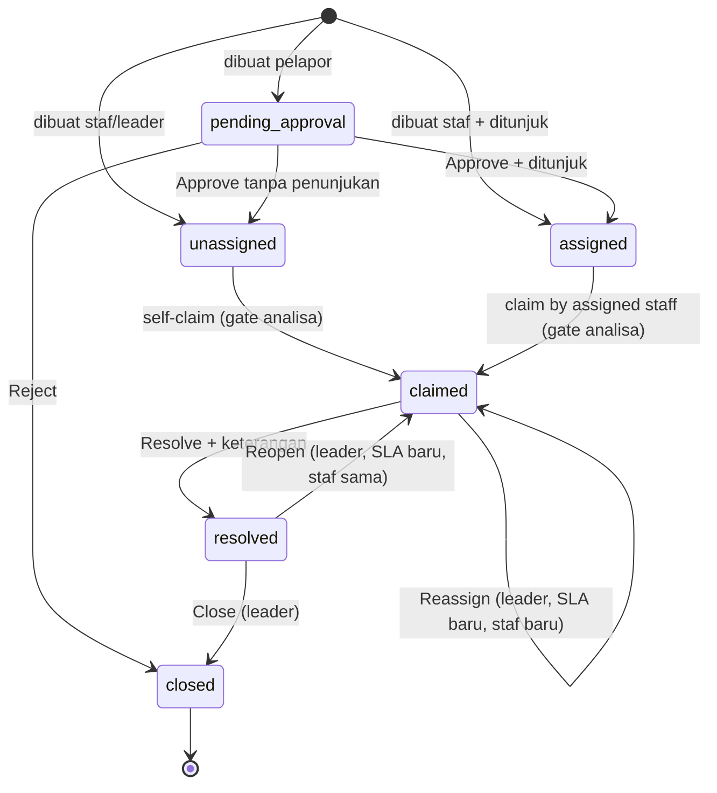

# Alur Tiket & Laporan KPI — Sistem Ticketing IT RS

Dokumen ini merekam alur kerja yang **sedang berjalan** di sistem (per November 2026), beserta jalur dari tiket/daily task sampai ke laporan dan KPI. Sumber kebenaran: kode backend (`internal/service`, `internal/repository`, `migrations`) dan halaman frontend (`app/reports`, `app/reports/kpi`).

---

## 1. Role & kewenangan

| Role | Kewenangan utama |
|---|---|
| `pelapor` (`user`) | Buat tiket, lihat dokumen hasil unggahan, beri rating. **Tidak** bisa klaim/edit tiket, **tidak** bisa cetak BAST. |
| `it_support`, `analyst`, `programmer`, `devops` | Staf teknis: klaim tiket, isi analisa, resolve, catat daily task, masuk KPI staf. |
| `leader` | Atasan: setujui/tolak tiket, tutup tiket, reopen, reassign, ubah deadline, atur unit & kategori. TTD otomatis sebagai Leader IT di cetakan. |
| `admin` | Sama seperti leader + manajemen akses/RBAC, soft-delete tiket. |

Role bersifat dinamis (kolom `role` bertipe teks sejak migrasi `000036`). Helper `IsSupervisor`, `IsTechnicalStaff`, `IsReporter` hanya memberi batasan dasar — **blokir aksi sebenarnya berasal dari izin modul `/me/permissions`**, bukan dari daftar role hardcoded.

---

## 2. Status tiket

Enum `ticket_status` (migrasi `000004` + `000012`):

```
pending_approval → unassigned → assigned → claimed → resolved → closed
```

| Status | Arti | Siapa mengubah |
|---|---|---|
| `pending_approval` | Tiket dari pelapor menunggu persetujuan leader/admin. Staf belum boleh melihat. | Sistem saat `Create` |
| `unassigned` | Tiket terbuka, boleh diklaim staf mana pun. | Leader/admin (`Approve`) atau sistem (`Create` oleh staf) |
| `assigned` | Ditujukan ke staf tertentu. Hanya staf itu yang boleh klaim. | Leader/admin (`Create`/`Approve`) |
| `claimed` | Sedang dikerjakan. `claimed_by` = pengerja; `claimed_at` = awal siklus SLA kerja. | Staf teknis (`Claim`) |
| `resolved` | Staf selesai mengerjakan + keterangan wajib. Menunggu review leader. | Staf yang mengklaim (`Resolve`) |
| `closed` | Selesai final. Pelapor dapat notifikasi untuk memberi rating. | Leader/admin (`Close`) |



---

## 3. Alur tiket langkah demi langkah

### 3.1 Pembuatan
1. Pelapor (`role = pelapor`) mengirim tiket → status `pending_approval`.
   - Notifikasi `ticket_pending_approval` dikirim ke semua `leader`/`admin`.
2. Staf/leader membuat tiket → status `unassigned`; bila leader menyertakan `assigned_to` → `assigned`.
   - Kalau dibuat untuk orang lain (`created_for`), pemohon dapat notifikasi `ticket_created_for_you`.
3. Kode tiket otomatis per kategori: prefix `ACC`, `HW`, `NTWRK`, `SIMRS`, `SW`, format `SIMRS-00019`, counter dari tabel `ticket_code_counters`, `lpad(seq,5,'0')`.
4. SLA deadline dihitung **sejak tiket dibuat** dari `sla_rules` (kategori + prioritas), atau memakai `custom_deadline` bila leader mengisi manual. Custom deadline tidak bisa diisi pelapor/staf biasa.

### 3.2 Persetujuan
- `Approve` (leader/admin): `pending_approval` → `assigned` (bila ada `assigned_to`) atau `unassigned`. Deadline hanya ditimpa bila leader mengisi custom deadline; jika tidak, `COALESCE($5, sla_deadline)` mempertahankan deadline awal.
- `Reject` (leader/admin): `pending_approval` → `closed`, alasan wajib, tersimpan sebagai komentar `general_comment`, pemohon dapat notifikasi `ticket_rejected`.

### 3.3 Klaim + gate dokumen analisa
- Staf teknis mengklaim tiket:
  - `assigned` → hanya staf yang ditunjuk (`ErrNotAssignedStaff`).
  - `unassigned` → siapa pun (`self_claimed`); staf lain dapat notifikasi real-time `ticket_claimed`.
- **Gate persetujuan analisa**: bila `COALESCE(tickets.analysis_approval_required, categories.requires_analysis_approval)` bernilai `true`, klaim ditolak `412` dengan pesan `tiket ini wajib memiliki scan persetujuan analisa bertanda tangan sebelum diklaim` sampai scan dokumen `analysis` diunggah.
- Upload dokumen saat `resolved` **tidak wajib**.

### 3.4 Pengerjaan & penyelesaian
- `Resolve` (hanya `claimed_by`): `claimed` → `resolved`, wajib keterangan, lampiran opsional, komentar `resolve_note`. Catatan: `last_resolved_at = now()`.
- `Close` (leader/admin): `resolved` → `closed`; notifikasi `ticket_closed` ke pelapor + ajakan rating.
- `Reopen` (leader/admin): `resolved` → `claimed`, alasan wajib, `claimed_by` tetap staf yang sama, `reopen_count + 1`, SLA dihitung ulang dari waktu reopen, notifikasi `sla_reminder_sent_at` direset.
- `Reassign` (leader/admin): `claimed` → `claimed` dengan staf baru, alasan wajib, `claimed_at` dan SLA direset supaya staf baru dapat waktu penuh.
- `UpdateDetails`: judul/deskripsi/kategori/prioritas bisa diubah kapan saja selama tiket belum `closed`, oleh staf teknis atau supervisor.
- `UpdateAnalysis`: catatan analisa oleh staf teknis/supervisor; actor tersimpan di `tickets.analysis_by` (bukan `claimed_by`).

### 3.5 Dokumen cetak
- **Persetujuan Analisa** — 3 tanda tangan: Pemohon (nama dikosongkan, bisa beda orang), Analyst (dari `analysis_by_name`), Koordinator IT (role `leader`).
- **BAST** — 4 tanda tangan: Manajer pelapor, Analyst, Programmer/pengerja (dari `claimed_by_name || assigned_to_name`), Koordinator/Leader IT.
- Cetak BAST hanya untuk tiket `closed` dan `role !== 'pelapor'`. Pelapor hanya melihat hasil unggahan.
- Nomor dokumen otomatis per `ticket_id`, `doc_type`, tahun (`ticket_document_numbers`).

### 3.6 SLA & pengingat
- Background job `CheckSLAReminders` berjalan berkala, mengecek tiket yang mendekati/lewat `sla_deadline`.
- Jendela pengingat = 30 menit sebelum deadline; kolom `sla_reminder_sent_at` dan `sla_overdue_notified_at` mencegah notifikasi ganda.
- Tiket yang di-reopen atau di-reassign mendapat deadline baru.

### 3.7 Soft-delete
Admin dapat menghapus tiket (`deleted_at`). Tiket terhapus **tidak ikut** statistik maupun KPI. Daily task dihapus permanen (hard delete).

---

## 4. Daily task (alur terpisah)

Daily task adalah pekerjaan kecil dari chat WhatsApp yang tidak jadi tiket resmi, tapi tetap dihitung sebagai beban kerja staf di KPI. Tersimpan di tabel `daily_tasks`, terpisah dari `tickets`.

Field utama: tanggal (`task_date`), pelapor (teks bebas, bukan FK user), unit (dropdown `units`: SIMRS, IGD, Jaringan, dll), kendala (`issue`, memakai kategori), detail kendala, solusi, jam komplain, mulai, selesai, lampiran 0–5 file (PDF/JPG/PNG/WEBP, maks 5 MB/file).

Dua metrik dihitung database (generated column, bukan frontend):
- `response_minutes = start_at - complain_at` (kecepatan respons; `GREATEST(0, ...)`).
- `duration_minutes = end_at - start_at` (lama pengerjaan).

Yang dihitung di KPI adalah **`created_by`** (pencatat/staf), bukan `reporter_name`.

---

## 5. Dari laporan ke KPI

### 5.1 Endpoint

| Endpoint | Fungsi |
|---|---|
| `GET /reports/kpi` | Ringkasan lintas tiket: status, SLA, prioritas, kategori, staf terbaik |
| `GET /reports/trend?from&to` | Tren tiket dibuat vs diselesaikan per hari |
| `GET /reports/daily-trend?from&to[&staff_id]` | Tren daily task dicatat vs selesai per hari |
| `GET /reports/priority-breakdown` | Distribusi prioritas (pie chart tiket) |
| `GET /reports/category-breakdown` | Distribusi kategori |
| `GET /reports/staff-performance` | Performa staf |
| `GET /reports/kpi/staff?from&to[&staff_id]` | KPI per staf (tabel + leaderboard) |
| `GET /reports/kpi/detail?...` | Rincian tiket dianalisa & daily task per staf |
| `GET /reports/kpi/export?...` | Ekspor CSV |

Semua endpoint memakai filter periode `from`/`to`; `staff_id` opsional, di-resolve dari peran (leader/admin bisa melihat semua, staf hanya dirinya).

### 5.2 Halaman

**`/reports`** — Ringkasan operasional:
- Kartu ringkasan: total tiket, selesai, dalam proses, SLA terlewat, rata-rata response/resolution time.
- Narasi otomatis (mis. "Pada periode ... tercatat 6 tiket masuk, 33% sudah diselesaikan").
- **Line chart tiket** (Dibuat vs Diselesaikan) dan **line chart daily task** (Dicatat vs Selesai) berdampingan.
- Pie chart distribusi prioritas tiket.
- Tabel staf: tiket selesai, rata-rata waktu, kepatuhan SLA.
- Ekspor PDF via jsPDF lengkap dengan kop surat + logo RS + TTD 2 kolom.

**`/reports/kpi`** — KPI per staf:
- Filter periode + dropdown staf.
- Kartu: tiket dibuat, dianalisa, diselesaikan, daily task, total item kerja.
- Dua line chart yang sama (ikut filter staf).
- Tabel: tiket selesai, rata-rata waktu, kepatuhan SLA, reopens, daily task, rata-rata durasi & response.
- Rincian tiket dianalisa + daily task; ekspor CSV; cetak HTML.
- Cetak KPI: kop formal + logo RS, TTD **Mengetahui — Leader IT** (diambil otomatis dari role `leader`) dan **Menetapkan — Direktur RS**; dua kolom, center, dengan jarak sebelum garis tanda tangan.

### 5.3 Rumus metrik KPI

| Metrik | Sumber | Rumus |
|---|---|---|
| Tiket diselesaikan | `tickets` | `COUNT(*)` status `resolved`/`closed`, `claimed_by` = staf, `deleted_at IS NULL` |
| Rata-rata waktu selesai | `tickets` | `AVG(last_resolved_at - claimed_at)` menit |
| Kepatuhan SLA | `tickets` + `sla_rules` | `last_resolved_at <= claimed_at + resolution_time_minutes` |
| Tiket dianalisa | `tickets.analysis_by` | `COUNT(*)` per actor analisa |
| Tiket dibuat | `tickets.created_by` | `COUNT(*)` per pembuat |
| Daily task | `daily_tasks.created_by` | `COUNT(*)` per pencatat |
| Rata-rata durasi harian | `daily_tasks` | `AVG(duration_minutes)` |
| Rata-rata response harian | `daily_tasks` | `AVG(response_minutes)` |
| Avg Response Time (`/reports`) | `tickets` | `AVG(claimed_at - created_at)` menit — beda dengan response harian |

Staf tanpa aktivitas tidak muncul di leaderboard. Data terhapus tidak dihitung.

---

## 6. Peta alur end-to-end (ringkas)

```mermaid
flowchart LR
    A[Pelapor buat tiket] --> B{pelapor?}
    B -- ya --> C[pending_approval]
    C --> D{Approve / Reject}
    D -- Approve --> E[unassigned / assigned]
    D -- Reject --> Z[closed]
    B -- tidak --> E
    E --> F[Claim staf teknis]
    F --> G{gate analisa aktif?}
    G -- ya, belum ada scan --> H[412: upload scan analisa]
    H --> F
    G -- tidak/ada --> I[claimed]
    I --> J[Resolve + keterangan]
    J --> K[resolved]
    K --> L{Review leader}
    L -- Close --> Z
    L -- Reopen --> I
    I -- Reassign --> I
    Z --> M[BAST & cetak]
    E & I & Z --> N[/reports]
    O[Daily task WA] --> P[daily_tasks]
    N & P --> Q[/reports/kpi]
    Q --> R[CSV / PDF + TTD]
```

---

## 7. Catatan pemeliharaan

- Jangan memblokir aksi hanya dari daftar role frontend; selalu cek `/me/permissions`.
- `analysis_by` adalah actor analisa; `claimed_by`/`assigned_to` adalah actor pengerja.
- Filter soft-delete pada `LEFT JOIN` harus diletakkan di klausul `ON`, bukan `WHERE`, supaya baris tanggal kosong tidak ikut terfilter.
- Line chart harian memakai `generate_series` agar hari tanpa data tetap jadi titik 0.
- Kop surat dan TTD memakai komponen bersama `ReportLetterhead` + `institution.ts` + `logorsih.png`.

---

*Disusun berdasarkan implementasi aktif di `C:/laragon/www/ticketing-it`. Bila alur berubah lewat migrasi baru, perbarui dokumen ini.*
